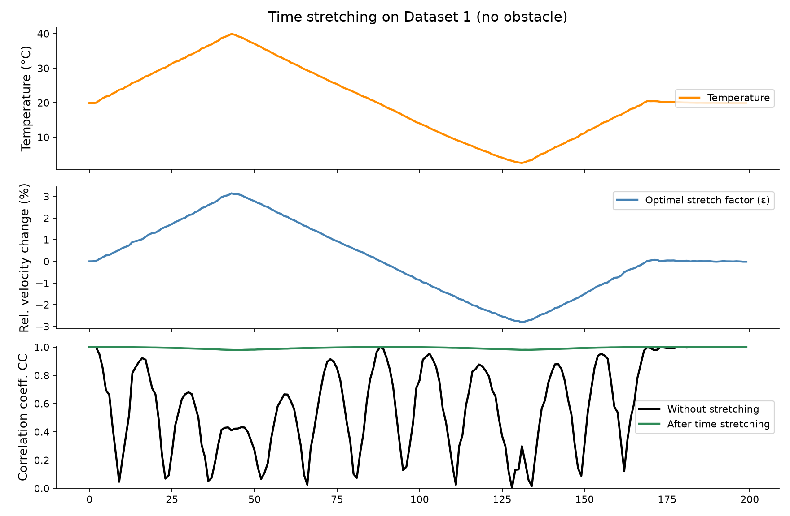
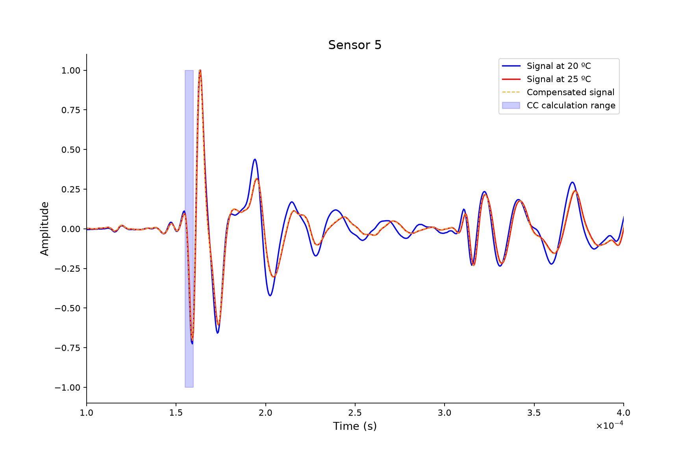

# tc-cwi-workflows

[](https://www.python.org/downloads/)
[](https://pypi.org/project/tc-cwi/)
[](LICENSE)
[](https://doi.org/10.5281/zenodo.19139843)
[](https://doi.org/10.5281/zenodo.19209079)

Reproducible research workflows for **Environmental and Operational Condition (EoC) compensation** in ultrasonic Structural Health Monitoring (SHM) using **Coda Wave Interferometry (CWI)** and the **Time-Stretching method**.

This repository contains executable analysis pipelines replicating the experimental findings from two EWSHM 2026 studies (ULB and Airbus/UGE). Computational algorithms are decoupled and provided by the upstream PyPI package [`tc-cwi`](https://pypi.org/project/tc-cwi/) (`>=0.1`).

---

## Overview

Temperature variations induce apparent wave velocity changes in ultrasonic guided waves, masking structural damage. This repository provides:
1. **ULB Workflow (`scripts/ulb_workflow.py`):** Pitch-catch ultrasonic acquisitions across variable thermal cycles, demonstrating baseline temperature compensation (Dataset 1), moving-average reference compensation (Dataset 2), and obstacle sensitivity detection.
2. **Airbus Workflow (`scripts/airbus_workflow.py`):** Ingestion of SEG-2 ultrasonic acquisitions from composite panel monitoring, temporal alignment with environmental logs (temperature & humidity), and sensor correlation coefficient analysis.
3. **Publication-Ready Visualizations (`scripts/plotting.py`):** Figure generation routines replicating the published charts in EWSHM 2026 proceedings.

The core time-stretching optimization algorithm and MATLAB-compatible dispatch interface (`getccns`, `stretch`, `getccs`, `findeps`, `findeps -ma`) are provided via [`tc-cwi`](https://pypi.org/project/tc-cwi/).

---

## Repository Structure

```text
tc-cwi-workflows/
├── LICENSE                    # MIT License (Copyright (c) 2026 aderaema)
├── README.md                  # Project documentation & reproducibility guide
├── TASK.md                    # Project roadmap and milestone tracking
├── pyproject.toml             # Project metadata & dependencies
├── docs/
│   └── figures/               # Curated publication figures
│       ├── airbus_sensor_5.png
│       └── ulb_results_dataset1.png
├── figures/                   # Runtime figure output directory (gitignored)
├── scripts/
│   ├── airbus_workflow.py     # Airbus SEG-2 ingestion & correlation analysis
│   ├── plotting.py            # Standardized publication plotting routines
│   └── ulb_workflow.py        # ULB temperature compensation & obstacle sensitivity
└── tests/
    ├── test_airbus_workflow.py # Normalization and synthetic correlation tests
    └── test_ulb_workflow.py    # Obstacle sensitivity & tc-cwi package dispatch tests
```

---

## Installation & Setup

Requirements: **Python ≥ 3.11**

### 1. Developer Setup (Recommended with `uv`)

This repository uses [`uv`](https://github.com/astral-sh/uv) for fast, reproducible dependency management:

```bash
# Clone the repository
git clone https://github.com/Zensor-BE/tc-cwi-workflows.git
cd tc-cwi-workflows

# Create virtual environment and install dependencies (including tc-cwi>=0.1 from PyPI)
uv sync
```

### 2. Standard `pip` Installation

```bash
# Clone and install in current environment
git clone https://github.com/Zensor-BE/tc-cwi-workflows.git
cd tc-cwi-workflows
pip install .
```

---

## Dataset Download (Zenodo)

Experimental datasets are decoupled from git tracking and archived on Zenodo. Download the datasets and unpack them into the `data/` directory:

### 1. ULB Dataset (Record 19139843)
- **DOI:** [10.5281/zenodo.19139843](https://doi.org/10.5281/zenodo.19139843)
- **Archive Contents:**
  - `data01.mat` & `Temperature_data01.mat` (Dataset 1: baseline temperature cycles without obstacle)
  - `data02.mat` & `Temperature_data02.mat` (Dataset 2: temperature cycles with obstacle insertion)
- **Destination:** Extract files into `data/ULB/`:
  ```text
  data/ULB/
  ├── Temperature_data01.mat
  ├── Temperature_data02.mat
  ├── data01.mat
  └── data02.mat
  ```

### 2. Airbus Dataset (Record 19209079)
- **DOI:** [10.5281/zenodo.19209079](https://doi.org/10.5281/zenodo.19209079)
- **Archive Contents:**
  - `seg2_data_june2024.zip` (220 SEG-2 acquisitions in `ONDULYS/`)
  - `temp_and_humidity_data_june2024.zip` (`USER-2024-06-26.xlsx`)
- **Destination:** Extract archives into `data/Airbus/` (or directly into `data/`):
  ```text
  data/Airbus/
  ├── seg2_data_june2024/
  │   └── ONDULYS/
  │       ├── 1_0_228_LUT_20240619_composite_monitor_02.sg2
  │       └── ... (220 files)
  └── temp_and_humidity_data_june2024/
      └── USER-2024-06-26.xlsx
  ```

---

## Reproducing Research Workflows

### 1. ULB Workflow (Temperature Compensation & Obstacle Sensitivity)

Replicates the time-stretching temperature compensation analysis (Figures 5 & 6 in EWSHM 2026 paper):

```bash
# Run Dataset 1 (baseline temperature compensation without obstacle)
uv run python scripts/ulb_workflow.py --dataset 1

# Run Dataset 2 (obstacle insertion with fixed vs moving-average reference)
uv run python scripts/ulb_workflow.py --dataset 2

# Quick smoke test on both datasets with subsampling
uv run python scripts/ulb_workflow.py --dataset both --subsample 100
```

Figures are saved to `figures/`.

### 2. Airbus Workflow (SEG-2 Ingestion & Environmental Correlation)

Parses SEG-2 ultrasonic files, matches acquisition timestamps with environmental logs, and evaluates correlation coefficients across temperature variations:

```bash
# Run analysis on Sensor 1 across peak temperature bounds
uv run python scripts/airbus_workflow.py --peaks 1 --temp1 20.0 --temp2 25.0 --sensor 1
```

### 3. Running Verification Tests

Run the test suite verifying workflow metric calculations, data normalization, and `tc_cwi` package execution:

```bash
uv run pytest
```

---

## Results

### ULB Pitch-Catch Temperature Compensation (Dataset 1)

Baseline temperature compensation across thermal cycles without structural modifications. Coda Wave Interferometry (CWI) time-stretching compensates for temperature-induced velocity shifts, maintaining high correlation coefficients across the thermal range:



### Airbus Composite Panel Lamb Waves (Sensor 5)

Detailed waveform comparison and correlation coefficient under temperature variations on composite panel Sensor 5:



---

## Citation

If you use these workflows, datasets, or the `tc-cwi` package in your research, please cite the corresponding publications and Zenodo datasets:

### ULB Paper (EWSHM 2026)
```bibtex
@inproceedings{sharma2026strategies,
  title={Strategies for Improving the time stretching Method for Temperature Compensation in Ultrasonic Structural Health Monitoring},
  author={Sharma, Jitendra and Deraemaeker, Arnaud},
  booktitle={Proceedings of the 12th European Workshop on Structural Health Monitoring (EWSHM 2026)},
  year={2026},
  doi={10.58286/33693}
}
```

### Airbus / UGE Paper (EWSHM 2026)
```bibtex
@inproceedings{trezza2026experimental,
  title={Experimental Analysis of Lamb Waves in Composite Panel Under Variable Temperature Conditions},
  author={Trezza, Luigi and Garc{\'i}a Alonso, Jaime and Justicia Alados, Manuel Jes{\'u}s and Guerrero Vazquez, Santiago and Fernandez Lopez, Antonio and Deraemaeker, Arnaud and Sharma, Jitendra Kumar and Durand, Olivier and Abraham, Odile},
  booktitle={Proceedings of the 12th European Workshop on Structural Health Monitoring (EWSHM 2026)},
  year={2026},
  doi={10.58286/33923}
}
```

### ULB Dataset (Zenodo)
```bibtex
@misc{ulb_dataset_2026,
  title={ULB Ultrasonic Pitch-Catch Temperature Compensation Dataset},
  author={Sharma, Jitendra and Deraemaeker, Arnaud},
  year={2026},
  publisher={Zenodo},
  doi={10.5281/zenodo.19139843},
  url={https://doi.org/10.5281/zenodo.19139843}
}
```

### Airbus Dataset (Zenodo)
```bibtex
@misc{airbus_dataset_2026,
  title={Lamb wave propagation in composite panels under variable temperature conditions},
  author={Trezza, Luigi and Durand, Olivier and Abraham, Odile and Deraemaeker, Arnaud},
  year={2026},
  publisher={Zenodo},
  doi={10.5281/zenodo.19209079},
  url={https://doi.org/10.5281/zenodo.19209079}
}
```

---

## License

This project is licensed under the MIT License — see the [LICENSE](LICENSE) file for details.

Copyright (c) 2026 Arnaud Deraemaeker, Damiano Gianotti, Jitendra Kumar Sharma, Luigi Trezza.
